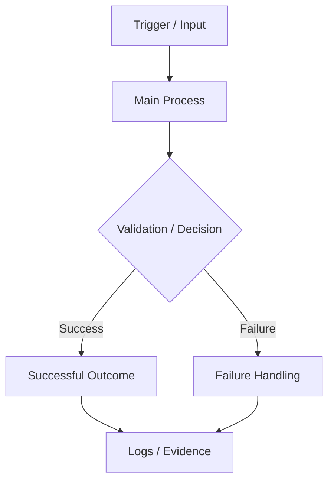

# Capstone Mission: [Mission Name]

> **How to use this template (authors):** This is a reusable template for building practical, story-based capstone projects. Fill in every **[bracketed prompt]** with details for your course, and keep only the sections that fit your project. Write to the learner as "you." Delete this note and the Instructor Notes at the end before sharing the brief with learners.

**The story in one line:** [A short, memorable description of the challenge.]
**Course / cohort:** [Course and cohort]
**Difficulty:** [Beginner / Intermediate / Advanced]
**Estimated time:** [Hours or days]
**Related modules:** [Module numbers and topics]
**What you'll submit:** [Repository / report / screenshots / demo / other]

---

## 1. The Situation

### The request that just landed

> It's [time, day, or event] at **[fictional company or team]**. The team is dealing with **[current problem]**. Right now, **[describe the manual, slow, unreliable, or risky way things work]**, and that's causing **[impact on the business or users]**.
>
> You've been brought in as the **[your role]**. Your mission is to build **[the solution or system]** so that **[desired outcome]** happens reliably, even when **[important constraint or failure]** comes up.

### Who's counting on you

| Who | What they need from you |
|---|---|
| [Team or user 1] | [What they need or expect] |
| [Team or user 2] | [What they need or expect] |
| [Owner or approver] | [What they'll check before accepting your work] |

### Why this matters

- **The problem today:** [What's hard, manual, slow, expensive, or risky right now?]
- **If nothing changes:** [What could go wrong?]
- **What success looks like:** [Describe the result in plain, everyday language.]

---

## 2. Your Mission

Build **[a short description of what you need to deliver]**. It needs to:

1. [Do the main thing it's built for.]
2. [Support a second workflow or capability.]
3. [Behave sensibly when something goes wrong.]
4. [Give you a way to prove it works.]

**You've succeeded when:** [One measurable sentence describing the final result.]

---

## 3. What You'll Practice

By the end of this mission, you'll be able to:

- [Learning objective 1]
- [Learning objective 2]
- [Learning objective 3]
- [Learning objective 4]

Here's how earlier lessons show up in this project. Nothing here should surprise you. *(Authors: if you add a topic learners haven't been taught, mark it clearly as optional research.)*

| Module / lesson | What you learned | Where it shows up here | What you'll show |
|---|---|---|---|
| [Module 1] | [Concept] | [Task or component] | [What you submit or demonstrate] |
| [Module 2] | [Concept] | [Task or component] | [What you submit or demonstrate] |
| [Module 3] | [Concept] | [Task or component] | [What you submit or demonstrate] |

---

## 4. Ground Rules

These are the boundaries for the mission. They tell you what to stay within, not how to build it. How you solve it is up to you.

| Area | The rule |
|---|---|
| Where it runs | [Local machine, sandbox, cloud account, VM, etc.] |
| Tools you must use | [Required languages, services, tools, or versions] |
| Access | [Accounts, permissions, credentials, or access limits] |
| Security | [How to handle secrets, data, and permissions] |
| Cost | [Budget, free-tier limits, or resources to avoid] |
| Timing | [Deadline, how often something should run, or time limit] |
| Don't do this | [What's off limits] |

### What's in and what's out

| In scope (you build this) | Out of scope (you can skip this) |
|---|---|
| [What you must build] | [What you don't need to build] |
| [Required integration or behavior] | [Advanced feature we're leaving out on purpose] |

---

## 5. Your Starter Kit

Here's what you're given to get going.
*(Authors: only list things that are actually provided. Don't assume a file, account, or service exists.)*

| What you get | Who provides it | What it's for |
|---|---|---|
| [Starter repository or folder] | [Instructor / course] | [Purpose] |
| [Sample data or test input] | [Instructor / course] | [Purpose] |
| [Configuration or environment] | [Instructor / you] | [Purpose] |
| [Diagram, API, or documentation] | [Source] | [Purpose] |

### Quick check before you begin

- [ ] I can get into the environment I need.
- [ ] I have the right tools and versions installed.
- [ ] I've copied or cloned the starter files.
- [ ] I understand the cost, access, and security rules.
- [ ] I know how to clean up anything I create.

---

## 6. The Big Picture

Here's the general flow of the solution. Think of it as a map of the problem, not the only route to the answer. *(Authors: swap in your real components.)*



### The pieces and your part in them

| Piece | What it does | Your job |
|---|---|---|
| [Component 1] | [What it does] | [Build / configure / test / connect it] |
| [Component 2] | [What it does] | [Build / configure / test / connect it] |
| [Component 3] | [What it does] | [Build / configure / test / connect it] |
| [Logging / evidence] | [How you see what happened] | [What proof to capture] |

**Good to know:** [Mention any important dependency, order of operations, or hand-off between pieces.]

---

## 7. The Stages

Work through these in order. Each stage builds on the one before it. *(Authors: add or remove stages to fit your subject.)*

### Stage 1: Look around first

**Goal:** [What you need to inspect, plan, or prepare before you build anything.]

**What to do**
1. [Read through the starter files and requirements.]
2. [Work out the inputs, outputs, dependencies, and limits.]
3. [Sketch your approach or write a short plan.]

**You're done when:** [Something you can see or check.]
**Keep as proof:** [Plan, diagram, notes, screenshot, etc.]

### Stage 2: Get the basics working

**Goal:** Build the smallest version that works when everything goes right.

**What to do**
1. [Create the first component or script.]
2. [Connect the required pieces.]
3. [Run a normal, valid scenario.]
4. [Capture the result you expected to see.]

**You're done when:** [A measurable success condition.]
**Keep as proof:** [Logs, output, screenshot, commit, or demo.]

### Stage 3: Plot twist! Something goes wrong

**Goal:** Show that your solution doesn't fall apart the moment things aren't perfect.

**The twist:** [A malformed input, missing dependency, bad configuration, failed request, duplicate event, or another realistic problem.]

**What to do**
1. [Trigger the problem using the test input or setup you're given.]
2. [Run your solution and watch what it does.]
3. [Check that the problem is handled safely and that you can see it happened.]
4. [Write down what happened and, if needed, put the environment back the way it was.]

**You're done when:** [The expected failure behavior is shown.]
**Keep as proof:** [Failure log, rejected output, error message, screenshot, or test result.]

### Stage 4: Make it dependable

**Goal:** [Show that it runs on its own, can be repeated, recovers, scales, or has another reliability quality.]

**What to do**
1. [Set up the trigger or automation.]
2. [Test a repeat run, a retry, or a similar condition.]
3. [Check that nothing is duplicated, corrupted, or accidentally overwritten.]
4. [Capture proof that the trigger or repeat actually happened.]

**You're done when:** [A measurable reliability condition.]
**Keep as proof:** [Schedule entry, run record, test output, etc.]

### Stage 5: Lock it down and hand it over

**Goal:** Leave something that another person can understand, run, and trust.

**What to do**
1. [Check that credentials, permissions, configuration, and sensitive files are handled properly.]
2. [Review your logs and outputs. Do they tell the story of what happened?]
3. [Write down how to run it, test it, and clean it up.]
4. [Prepare a short walkthrough or handover report.]

**You're done when:** [Security and handover conditions are met.]
**Keep as proof:** [Configuration review, repo status, README, report, or demo.]

---

## 8. What Must Be True When You Finish

Each requirement below can be tested. *(Authors: avoid vague words like "good," "proper," or "working" unless you explain exactly how they'll be checked.)*

| ID | Requirement | How it's tested | What a pass looks like |
|---|---|---|---|
| AC-01 | [Core behavior] | [Test or observation] | [Specific expected result] |
| AC-02 | [Failure handling] | [Test or observation] | [Specific expected result] |
| AC-03 | [Repeatability or automation] | [Test or observation] | [Specific expected result] |
| AC-04 | [Security or configuration] | [Test or observation] | [Specific expected result] |
| AC-05 | [Logging or documentation] | [Test or observation] | [Specific expected result] |

---

## 9. Prove It: Test Plan

Show that your solution works by running these tests and capturing what you see. Only mark a test **Not applicable** if your scenario truly doesn't need it.

| Test | What you do | What should happen | What to capture | Done |
|---|---|---|---|---|
| Normal run | [Run with valid input under normal conditions] | [Expected successful result] | [Evidence] | [ ] |
| When it goes wrong | [Trigger the planned problem] | [Safe, expected failure behavior] | [Evidence] | [ ] |
| Doing it twice | [Repeat the same run or request] | [No unwanted duplicates or damage] | [Evidence] | [ ] |
| Automatic trigger | [Wait for, or manually fire, the trigger] | [The run happens as set up] | [Evidence] | [ ] |
| Security check | [Look at secrets, permissions, and sensitive files] | [Nothing exposed that shouldn't be] | [Evidence] | [ ] |
| Cleanup | [Follow your cleanup steps] | [Resources and temporary data are handled as required] | [Evidence] | [ ] |

---

## 10. What to Hand In

*(Authors: replace or remove rows that don't apply.)*

| What | What to include | Required? |
|---|---|---|
| Project files | [Source code, configuration, scripts, or infrastructure files] | Yes |
| README / runbook | How to set up, run, test, and clean up | Yes |
| Proof it works | Evidence from your normal run | Yes |
| Proof it handles failure | Evidence from the failure test | Yes |
| Proof of automation | Evidence of the trigger or repeat behavior | [Yes / No] |
| Proof of security checks | Evidence of the required security checks | [Yes / No] |
| Capstone report | A short write-up of your design, decisions, results, and limitations | Yes |
| Demo | [Live walkthrough / recorded demo / presentation] | [Yes / No] |

### A suggested folder layout

Change this to suit your technology. Don't require folders your project doesn't need.

```text
[project-name]/
├── README.md
├── src/                 # Main implementation
├── config/              # Non-secret configuration
├── tests/               # Test inputs and validation scripts
├── docs/                # Diagram, report, and evidence notes
└── .gitignore
```

---

## 11. Your Runbook

Write this so a teammate could run your solution without having to ask you how.

- **Set up:** [What to do before the first run.]
- **Run it:** [How to start it or trigger it.]
- **Check it:** [Where to look to see the result.]
- **If something breaks:** [The first things to check.]
- **Clean up:** [How to safely remove resources or reset test data.]

---

## 12. Good to Know

| Platform / environment | Notes, differences, or limits |
|---|---|
| [Environment 1] | [What to expect or any setup note] |
| [Environment 2] | [What to expect or any setup note] |

**What this project doesn't cover:** [Be upfront about what the capstone leaves out. Don't suggest a training exercise is ready for production unless it was designed and assessed for that.]

---

## 13. The Debrief: Tell the Story of Your Build

In your capstone report, answer these in your own words:

1. What problem were you asked to solve, and what did you build?
2. Which design decision mattered most, and why?
3. What happened in the failure test, and how did your solution respond?
4. What shows that your solution is repeatable or automated?
5. What would you change before using this in a real production environment?

---

## 14. Side Quests (Optional)

These are bonus challenges for extra depth. They're never required to finish the mission.

- [ ] **Side quest 1: [Name].** [The extra challenge and what it shows.]
- [ ] **Side quest 2: [Name].** [The extra challenge and what it shows.]
- [ ] **Side quest 3: [Name].** [The extra challenge and what it shows.]

**Plot-twist ideas to adapt to your topic**

- The same valid input arrives twice.
- An input is incomplete or malformed.
- A service or dependency you rely on is down.
- A credential or setting is missing.
- The workload suddenly gets much bigger.
- A run is interrupted halfway and has to be retried safely.
- A change has to be rolled back without losing valid work.

---

## 15. How You'll Be Scored

*(Authors: adjust the weights to fit your course outcomes. This example totals 100 points.)*

| What we look at | What it means | Points |
|---|---|---:|
| Requirements met | Your solution meets the must-have criteria | 35 |
| It works end to end | The pieces work together and complete the main workflow | 25 |
| Testing and resilience | You've shown success, failure, and repeat behavior | 15 |
| Security and good habits | You followed the security, configuration, and repository rules | 15 |
| Documentation and explanation | Someone else can understand, run, check, and clean up your work | 10 |
| **Total** | | **100** |

### Assessment notes

- **To pass:** [Score needed, or the must-have criteria.]
- **Must-pass items:** [Any requirement that has to be met regardless of the overall score.]
- **Late or incomplete work:** [Course policy, if there is one.]

---

## 16. Final Self-Check

Before you submit, make sure you can say yes to each of these:

- [ ] I can explain the problem and the solution I built.
- [ ] I used the key ideas from earlier modules.
- [ ] The normal run works, and I captured proof.
- [ ] I tested the failure scenario and captured proof.
- [ ] I tested repeatability or automation, where required.
- [ ] I followed the security and repository rules.
- [ ] My README covers setup, running, checking, and cleanup.
- [ ] I can name one limitation and one improvement I'd make.

---

# Instructor Notes

*(Remove everything below before sharing with learners.)*

## A. Getting Ready

| What to prepare | Notes |
|---|---|
| Starter files / repository | [What needs preparing, and where it will be shared] |
| Test data and sample inputs | [What learners get for each test] |
| Accounts and access | [Who sets them up, and which permissions are needed] |
| Cost controls | [Budget, resource limits, shutdown rules] |
| Expected duration | [How long learners will need, and how long the session runs] |
| Cleanup and reset | [How resources are removed and the exercise is reset] |

## B. Instructor Checklist

- [ ] Every required tool and resource is available, or learners are told how to get it.
- [ ] The instructions never mention something that hasn't been provided.
- [ ] Every acceptance criterion has a test you can repeat.
- [ ] The failure scenario is safe and can be reproduced.
- [ ] Expected outputs are written down for assessors.
- [ ] Cleanup has been tested and leaves no billable resources running.
- [ ] Learners can finish using only what's been taught, or optional research is clearly labeled.

## C. Hints and Common Mistakes

| Stage | Hint if learners are stuck | Mistake to watch for |
|---|---|---|
| Look around | [Hint] | [Mistake] |
| Basics | [Hint] | [Mistake] |
| Plot twist | [Hint] | [Mistake] |
| Dependable | [Hint] | [Mistake] |
| Lock down and hand over | [Hint] | [Mistake] |

## D. Debrief Questions

- Which part of this felt most like real engineering work?
- What assumption did you have to rethink after testing?
- What did the failure test show you that the normal run didn't?
- What would need to change before a team could run this day to day?

---

## Quick Guide: Making a Capstone Feel Like a Mission

1. **Give learners a role.** For example: automation engineer, cloud engineer, platform support engineer, or junior SRE.
2. **Give the work a reason.** Tie the technical task to a fictional team's pain point, a customer need, a deadline, or a reliability goal.
3. **Add a twist.** Include at least one realistic problem or surprise they have to handle.
4. **Make success visible.** Ask for logs, test results, screenshots, repo evidence, or a demo, not just a written explanation.
5. **Keep it fair.** Teach or practice every must-have skill before the capstone. Keep unfamiliar extras optional.
6. **End with a handover.** Learners should explain how someone else can run, check, troubleshoot, and clean up their work.
