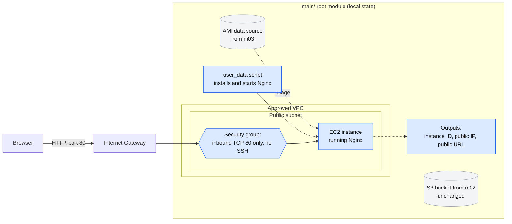

# Checkpoint: Frontend-Only Nginx Application

**The situation:** The lab project so far only holds a storage bucket. The team wants to see it serve a real web page before its state moves to the cloud.
**What this checks:** Variables, outputs and data sources from m03, plus the first compute and network exposure in the same project: a security group and `user_data`.
**How long it takes:** About 4 hours
**How the trainee works:** On their own
**What the trainee hands in:** The `main/` configuration, a short README, an apply screenshot and a browser screenshot of the Nginx page.

---

## 1. The Challenge

The `main/` project has a bucket, variables, outputs and a data source for the latest Amazon Linux image. Nothing in it can be opened in a browser yet. The trainee is the engineer asked to add a single web server to the same project, without disturbing the bucket, and to show that it works.

**The task:** Add one EC2 instance running Nginx to the existing `main/` root module and open its welcome page in a browser using the URL from an output.

**When done, the trainee will be able to:**
- Set up a security group that opens only port 80.
- Build an instance that installs and starts Nginx when it boots.
- Reach the welcome page from an output URL, and clean up as the instructor directs.

### What will be built

Everything below lives in the existing `main/` root module. The shaded pieces are what this checkpoint adds, and the S3 bucket stays exactly as it is.

---

## 2. Before Starting

Here is everything needed and a few boundaries, so the focus stays where it belongs.

| | What to know |
|---|---|
| **What is given** | The `main/` root module from m02 and m03 (bucket, variables, outputs, the AMI data source), still on local state. The instructor's approved VPC and public subnet, or a way to look them up |
| **How access works** | The sandbox account and authentication method from m02 |
| **Tools** | Terraform 1.10 or later, AWS CLI v2, a web browser |
| **Limits to keep in mind** | HTTP on port 80 only, for this temporary exercise. No public SSH. Only the sandbox-approved small instance type. Do not leave the instance running if the next session is not immediate. Do not delete the local state before m04 |
| **Not part of this lab** | HTTPS, SSH access, a custom web page, or anything production-grade. These are not graded |

**Where the lessons are used**

| Topic from class | Where it shows up in this lab |
|---|---|
| Data sources (m03) | Step 2: the AMI comes from the data source, not a hardcoded ID |
| Outputs (m03) | Step 2: instance ID, public IP and public URL |
| Reading a plan before apply (m01, m02) | Step 3: one instance and its security group are added, and the bucket is left alone |
| Security groups and exposure (new here) | Steps 1 and 2: only port 80 is open |

---

## 3. The Steps

Work through these in order. Each step sets up the next one.

| Step | What to do | It worked when... |
|---|---|---|
| **1. Get ready** | Open the `main/` project and check it still plans cleanly. Confirm the approved public subnet routes to an Internet Gateway and that an instance placed in it receives a public IPv4 address. Confirm the instance type with the instructor | `terraform plan` shows no unexpected changes, and a browser can reach an instance in that subnet |
| **2. Build it** | Add a security group in the approved VPC that allows inbound TCP port 80 only, with no public SSH. Using the AMI data source from m03, the approved subnet and the small instance type, create one EC2 instance with that security group. Pass a short `user_data` script that installs and starts Nginx on the selected Amazon Linux image. Add outputs for the instance ID, public IP and public URL, using HTTP | The configuration is written and ready to check |
| **3. Try it out** | Run `fmt`, `validate` and `plan`. Check the plan adds one EC2 instance and its security group and leaves the S3 bucket untouched. Apply it, then open the output URL in a browser | The Nginx welcome page is displayed |
| **4. Fix what's broken** | If the page does not load, work through the first checks: instance health, the `user_data` status and logs, the subnet route, the public IP, the security group's port 80, and whether Nginx is running. Note what was found | The page loads, and the cause is known. If it worked first time, the notes say so |
| **5. Wrap up** | Capture a terminal screenshot of the apply (no credentials shown) and a browser screenshot with the URL. Write a short README. Follow the instructor's cleanup instruction for the instance and keep the S3 bucket | There is proof it works, and nothing is left running or exposed |

---

## 4. How to Know It's Done

Run through this checklist before submitting.

| ID | What to check | How to check it | What a pass looks like |
|---|---|---|---|
| DoD-cp1.1 | **The security group is tight** | Read the inbound rules in the configuration and in the AWS console or CLI | Inbound port 80 only, with no SSH from the internet |
| DoD-cp1.2 | **The subnet is reachable** | Look at the subnet's route table and its public IP setting | It routes to an Internet Gateway and assigns a public IPv4 address |
| DoD-cp1.3 | **The plan was safe** | Read the plan reviewed before applying | It adds one instance and its security group and leaves the S3 bucket untouched |
| DoD-cp1.4 | **It works** | Open the URL from the output in a browser | The Nginx welcome page is displayed |
| DoD-cp1.5 | **The trainee understands it** | Read the short note | It explains the security group rule and the `user_data` script |
| DoD-cp1.6 | **It's tidy and safe** | Check the screenshots, files and the account | No credentials are exposed, the instance is stopped or destroyed as the instructor directed, and the bucket is kept |

---

## 5. What to Hand In

- [ ] The `main/` configuration including the Nginx instance
- [ ] `checkpoint-1/README.md` describing the resources, how to run it, how to check it, and how to clean up
- [ ] A terminal screenshot of the successful apply, with no credentials shown
- [ ] A browser screenshot showing the Nginx page and the URL used
- [ ] Notes on what went wrong and how it was fixed, if the page did not load first time
- [ ] A short note explaining the security group rule and the `user_data` script
- [ ] Cleanup evidence, if the instructor requests it

---

## 6. How It's Reviewed

| What is looked at | Weight |
|---|---:|
| It works and meets the requirements | Set by the instructor |
| The topics covered were used correctly | Set by the instructor |
| It was tested and problems were handled | Set by the instructor |
| The notes and cleanup | Set by the instructor |
| **Total** | **100%** |

**Must-haves:** inbound port 80 only with no public SSH (DoD-cp1.1), and no credentials in anything handed in (DoD-cp1.6).

---

## For Instructors

*(Remove this section before sharing the lab with trainees.)*

**Before the session**
- [ ] The approved VPC and public subnet are ready, or a network profile is provided if the sandbox has no usable default VPC.
- [ ] The small instance type is approved and the trainees know it.
- [ ] The cleanup instruction is decided: stop or destroy the instance, and when.
- [ ] A typical trainee can finish the required steps in about 4 hours.
- [ ] Expected results and pass conditions are written down: the Nginx welcome page, and the six checks in section 4.
- [ ] There is no planted problem. Step 4 only applies if the page does not load.
- [ ] Cleanup steps are tested, including removal of the instance.

**Decide before the session:** the review weights (the source guide gives none for checkpoints), and how deep the written explanations should be.

**Hints and common mistakes:** if the page does not load, the first checks are instance health, `user_data` status and logs, the subnet route, the public IP, the security group's port 80 and whether Nginx is running. Watch for public SSH, a hardcoded AMI ID, an unintended change to the bucket, and an instance left running.

**Suggested one-day schedule**

| Activity | Time |
|---|---:|
| Briefing and setup | 30 min |
| Main build | 2 hours |
| Testing and troubleshooting | 1 hour |
| Submission and review | 30 min |
