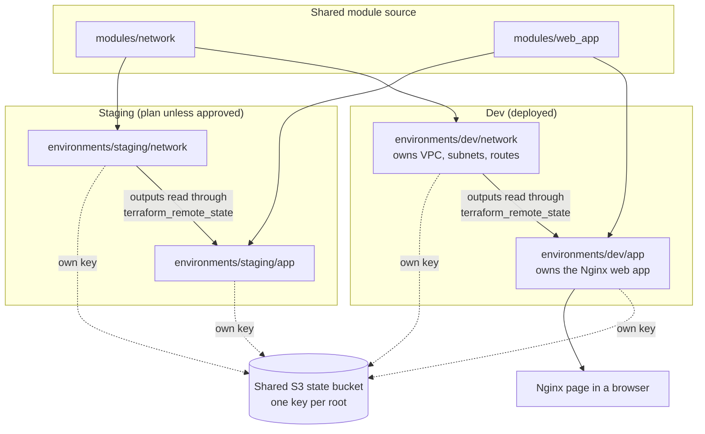

# Checkpoint: Complete Multi-Environment Setup

**The situation:** Before the capstone, the team wants proof that the trainee can run more than one independent Terraform root and explain how the layers connect.
**What this checks:** The m07 topics: separate directories per environment, unique state keys, sharing network outputs across a state boundary, and deployment and teardown order.
**How long it takes:** About 3 hours
**How the trainee works:** On their own
**What the trainee hands in:** The `multi-env/` repository, a backend and state map, and the evidence set.

---

## 1. The Challenge

The `multi-env/` project has a dev and a staging environment, each split into a network root and an app root with its own state key. A successful apply is not enough here. The team wants to see that every root stands on its own, and that the trainee can say what each folder owns and where it reads from.

**The task:** Show the finished `multi-env/` setup running as independent roots, and explain how the network and application layers connect.

**When done, the trainee will be able to:**
- Show that every root has its own state key.
- Prove the app root does not manage the network resources.
- Explain, for any folder, the backend key it uses, the resources it owns and the state it reads from.

### What will be shown

Nothing new is built in this checkpoint. The diagram is the finished m07 setup that is proved out: four independent roots, each with its own state key in the shared backend. The app root reads its network's outputs across the state boundary. The network is deployed before the app, and removed after it. Dev is deployed, and staging is a plan unless the instructor approved an apply.

Deploy order: network, then app. Teardown order: app, then network.

---

## 2. Before Starting

Here is everything needed and a few boundaries, so the focus stays where it belongs.

| | What to know |
|---|---|
| **What is given** | The finished `multi-env/` from m07: shared modules, and independent dev and staging network and app roots, with dev deployed |
| **How access works** | The sandbox account and authentication method from m02, as in m07 |
| **Tools** | Terraform 1.10 or later, AWS CLI v2, a web browser |
| **Limits to keep in mind** | No new resources beyond m07. Staging is a plan unless the instructor approved applying it. When the lab is retired, destroy the app resources before the network resources |
| **Not part of this lab** | New features, or a production environment beyond a plan-only directory. These are not graded |

**Where the lessons are used**

| Topic from class | Where it shows up in this lab |
|---|---|
| Directory segregation and unique state keys (m07) | Step 2: the backend and state map |
| Reading another root's outputs (m07) | Steps 3 and 4: the app root reads the network values |
| Deployment and teardown order (m07) | Steps 3 and 5: network before app, and app before network |
| The same modules with different tfvars (m07) | Step 4: staging has its own plan and state key |

---

## 3. The Steps

Work through these in order. Each step sets up the next one.

| Step | What to do | It worked when... |
|---|---|---|
| **1. Get ready** | Open `multi-env/` and check it has the shared modules and the four roots: dev and staging, network and app. Make sure `plan` can be run from each root | `plan` runs in any of the four roots |
| **2. Map it** | Write the backend and state map, with one row per root and the remote state key it uses | No two roots share a key |
| **3. Try it out** | Collect the deployment evidence, a successful dev network apply followed by a successful dev app apply, and the application evidence, the Nginx page in a browser | Both applies succeeded in that order and the Nginx page loads |
| **4. Prove the isolation** | Show that the app plan and apply do not manage the network resources, and that staging has its own plan and state key | The evidence shows each root owns only its own resources |
| **5. Wrap up** | Show the cleanup: app resources destroyed before network resources when the lab is retired. Practise explaining a folder's backend key, owned resources and state source without rereading | The cleanup evidence is in the right order, and the explanation needs no notes |

---

## 4. How to Know It's Done

Run through this checklist before submitting.

| ID | What to check | How to check it | What a pass looks like |
|---|---|---|---|
| DoD-01 | **The repository is complete** | Open `multi-env/` | It contains the shared modules and independent dev and staging network and app roots |
| DoD-02 | **Every root has its own state** | Read the backend and state map and each root's backend configuration | A unique remote state key for every root, and no two roots share a key |
| DoD-03 | **The deployment order worked** | Read the apply outputs | A successful dev network apply followed by a successful dev app apply |
| DoD-04 | **The application is live** | Open the Nginx URL in a browser | The deployed Nginx application is displayed |
| DoD-05 | **The layers are isolated** | Read the app plan and apply output and the staging plan | The app plan and apply do not manage the network resources, and staging has its own plan and state key |
| DoD-06 | **Cleanup is in order** | Read the destroy output | App resources are destroyed before network resources |
| DoD-07 | **The trainee can explain it** | Ask about any folder | The trainee explains the folder they are in, the backend key it uses, the resources it owns and the state it reads from. A successful apply alone is not enough |

---

## 5. What to Hand In

- [ ] The `multi-env/` repository with the shared modules and the four roots
- [ ] The backend and state map
- [ ] Evidence files for DoD-03 to DoD-06: screenshots, and plan and apply output

---

## 6. How It's Reviewed

| What is looked at | Weight |
|---|---:|
| It works and meets the requirements | Set by the instructor |
| The topics covered were used correctly | Set by the instructor |
| It was tested and problems were handled | Set by the instructor |
| The notes and cleanup | Set by the instructor |
| **Total** | **100%** |

**Must-haves:** DoD-07. The source guide's completion standard is that a successful apply alone is not enough.

---

## For Instructors

*(Remove this section before sharing the lab with trainees.)*

**Before the session**
- [ ] The trainees' m07 setup is deployed in dev, and the sandbox access and tools are ready.
- [ ] A typical trainee can finish the required steps in about 3 hours.
- [ ] Expected results and pass conditions are written down: the seven checks in section 4.
- [ ] There is no planted problem or failure case. The m07 debug exercise already covers a failure.
- [ ] Cleanup steps are tested, including destroying the app roots before the network roots.

**Decide before the session:** whether staging evidence is plan-only or applied, the format of the backend and state map, the review weights (the source guide gives none for checkpoints), and how deep the written explanations should be.

**Hints and common mistakes:** if an app root cannot read network values, check the network apply completed, the referenced key, the permissions and the region and account. If a state lock cannot be acquired, confirm nothing is applying and never force-unlock without proof the lock is stale. Watch for two roots pointing at one key.

**Suggested one-day schedule**

| Activity | Time |
|---|---:|
| Briefing and setup | 30 min |
| Gathering the evidence | 1.5 hours |
| Testing and troubleshooting | 30 min |
| Submission and review | 30 min |
