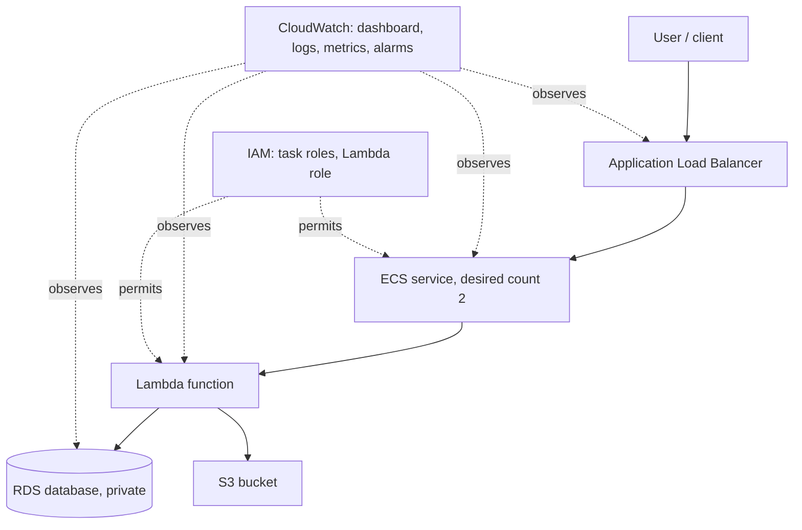

# Capstone Mission: Ship the Multi-Tier Service

**The story in one line:** A platform team has one afternoon to prove that a multi-tier AWS service can be built from reviewed code, approved before it is applied, kept alive when a task fails, and torn down without leaving anything behind.
**Course / cohort:** Terraform Bootcamp 2026 (cohort set by the instructor)
**Difficulty:** Advanced
**Estimated time:** About 20 hours
**Related modules:** m01 to m07, with checkpoints 1 and 3
**What the trainee submits:** A repository, architecture documentation, an evidence set, a runbook and a written report

---

## 1. The Situation

### The request that just landed

> It's the Monday before a launch review at **Brightwave Labs**. The platform team is dealing with **a service that was assembled by hand in the console**. Right now, **nobody can say which account owns the network, which settings the database really has, or in what order the pieces can be removed safely**, and that's causing **review delays, surprise cost, and a reluctance to touch anything in case it breaks**.
>
> The trainee has been brought in as the **platform engineer**. The mission is to build **the service's tiers as Terraform in independent state boundaries** so that **the whole stack can be reviewed, applied with approval, verified and removed** reliably, even when **one of the two compute tasks fails during the demonstration**.

### Who's counting on the trainee

| Who | What they need |
|---|---|
| The platform team | Reusable, reviewed code with clear state boundaries between the network foundation and the application, so a change in one layer does not disturb the other |
| The security reviewer | A private data tier, least-privilege roles, a locked-down bucket, and no credentials in the repository |
| On-call operations | A dashboard that shows application, compute and database health, and at least one alarm with a defined action |
| The instructor (sandbox owner) | Explicit approval before anything costly is applied, and a clean teardown that leaves the state backend and shared foundations in place |
| The next engineer | Documentation and a runbook that let them run, check, troubleshoot and clean up without asking |

### Why this matters

- **The problem today:** the service cannot be reproduced, reviewed or removed with confidence.
- **If nothing changes:** a launch built on settings nobody can read, and charges for RDS, load balancers and always-on compute that nobody remembers to stop.
- **What success looks like:** a request reaches the service through the load balancer, two compute tasks are healthy, the data tier is private, the proof is captured, the documentation hands the work over, and the stack is removed in reverse dependency order.

---

## 2. The Mission

Build **an ALB, an ECS service with two tasks, a Lambda function, a private RDS database, an S3 bucket, CloudWatch monitoring and IAM roles, as Terraform split into independent state boundaries**. It needs to:

1. Provide the flow from client to ALB to ECS service to Lambda to RDS and S3, in the approved single region.
2. Keep the data tier private and give every role only the access it needs.
3. Keep answering requests when one of the two ECS tasks fails, and show what the dashboard and alarm do.
4. Provide proof of each claim, and a handover that another engineer can use.

**The mission is complete when:** the application answers through the ALB with two healthy ECS tasks, the proof and documentation are submitted, and the stack has been torn down in reverse dependency order with the state backend still in place.

---

## 3. What the Trainee Will Practice

By the end of this mission, the trainee will be able to:

- Plan, deploy, validate, document and safely tear down a multi-tier AWS deployment.
- Separate infrastructure layers and accounts into independent root modules and state files, and share only the values another root needs.
- Build and consume reusable modules without over-modularising single-resource wrappers.
- Apply least-privilege roles and a private data tier without hardcoded credentials.

Here is how earlier lessons show up in this project. Steps are numbered across the whole mission (section 7) so they can be referred to.

| Module / lesson | What was learned | Where it shows up here | What is shown |
|---|---|---|---|
| m01 | Plan before apply; reading create, update and destroy actions | Stage 2 step 12, Stage 4 step 17, Stage 6 step 24 | Reviewed plans for every root (DoD-10, DoD-12) |
| m02 | Provider configuration, default tags, credentials kept out of code, a private versioned bucket | Stage 2, step 4 | S3 controls and a credentials check (DoD-04, DoD-08) |
| m03 | Variables, outputs, data sources, sensitive values | Stage 2, steps 3 and 5: values published between roots, module inputs and outputs | Module READMEs (DoD-06) |
| cp1 | Security groups and exposure | Stage 2, step 3: security group paths | A private database reachable only from the application (DoD-03) |
| m04 | Remote S3 state, unique keys, native locking | Stage 1, step 2: one key per root | The state key map (DoD-02) |
| m05 | Dependencies and lifecycle safeguards | Stage 2, step 4 and Stage 6, step 24: deletion protection and removal order | Teardown plans (DoD-15) |
| m05-5 | Locals, conditionals, readable expressions | Across the modules | Readable HCL (DoD-06) |
| m06 | Root and child modules, reusable network and service patterns | Stage 2, step 5 | Module READMEs (DoD-06) |
| m07 | Independent roots, reading another root's outputs, deploy and teardown order | Stages 1, 2 and 6 | The state map and teardown evidence (DoD-02, DoD-15) |
| **New here: research needed** | ECS, ALB, Lambda, RDS, CloudWatch and IAM roles and policies as Terraform resources. These were not taught in m01 to m07 | Stage 2, steps 3 to 11 | The AWS provider and AWS service documentation are read as the work goes |

---

## 4. Ground Rules

These are the boundaries for the mission. They say what to stay within, not how to build it. How it is solved is up to the trainee.

| Area | The rule |
|---|---|
| Where it runs | The instructor-approved sandbox, in a single region, for cost control |
| Tools to use | Terraform CLI 1.10 or later, AWS CLI v2, and the S3 backend with native locking, as in m04. Provider and module versions are pinned |
| Access | Instructor-provided accounts and roles, used through role assumption or the approved access path. No IAM users and no long-lived access keys |
| Security | No credentials in code, screenshots or Git. State files and saved plans are sensitive and not committed. RDS and private compute paths have no direct internet access. Roles are least privilege, avoiding broad wildcard permissions where practical. The S3 bucket blocks public access and uses encryption and versioning |
| Cost | RDS, NAT gateways, ALBs and continuously running compute cost money. Apply only in an approved sandbox window with explicit instructor approval, and destroy temporary resources after the demonstration |
| Timing | About 20 hours of effort. The instructor sets the window for applying |
| Don't do this | Apply without approval. Make the ALB internet-facing unless it is approved. Destroy the state backend or shared account foundations. Add modules that only wrap a single resource |

### What's in and what's out

| In scope (to build) | Out of scope (can be skipped) |
|---|---|
| The flow from client to ALB, ECS service, Lambda, RDS and S3 | Multi-region deployment |
| Independent state boundaries and reusable modules | Automated failover, replicated data or a recovery-time objective |
| A dashboard, an alarm and least-privilege roles | Claims of production readiness beyond the listed requirements |
| A reverse-order teardown that keeps the backend | Destroying the state backend or shared foundations |

---

## 5. The Starter Kit

Here is what is provided to get going. There is no starter repository, container image or sample application. The trainee starts from their own earlier work.

| What is provided | Who provides it | What it's for |
|---|---|---|
| Sandbox accounts, roles and the approved region | Instructor | The environment and access path for every root |
| The shared S3 state backend bucket | Instructor (set up in m04) | Remote state, one key per root |
| The trainee's own modules and multi-environment layout | Trainee (m06, m07) | The patterns to reuse for the network, service and observability pieces |
| The architecture target (section 6) | Course | The required relationships between the pieces |
| Terraform, AWS provider and AWS service documentation | HashiCorp, AWS | Research for the services that were not taught earlier |

### Quick check before beginning

- [ ] The trainee can get into the accounts and the role path needed.
- [ ] Terraform 1.10 or later and AWS CLI v2 are installed.
- [ ] The state backend bucket and the approved region are known.
- [ ] The cost, access and security rules are understood, and the approval window is agreed.
- [ ] The trainee knows how to clean up anything created.

---

## 6. The Big Picture

Here is the general flow of the solution. Think of it as a map of the problem, not the only route to the answer. The trainee explains how ECS invokes Lambda, how the application accesses RDS and S3, and which security groups and IAM permissions allow each interaction.

### What will be built



### The pieces and the trainee's part in them

| Piece | What it does | The trainee's job |
|---|---|---|
| Application Load Balancer | Receives client traffic and sends it to healthy targets | Create it, attach the ECS service, and confirm the health checks |
| ECS service | Runs the application with two tasks | Deploy it with a desired count of two and document the sizing |
| Lambda function | A decoupled function the application uses | Add the function and its invocation permissions, and explain the mechanism |
| RDS database | Holds application data in private subnets | Place it privately and allow only the application security group |
| S3 bucket | Holds application objects or artifacts | Block public access, and enable encryption and versioning |
| CloudWatch | Shows application, compute and database signals and raises alarms | Build the dashboard and at least one alarm with an action |
| IAM roles | Give each piece only what it needs | Define the task and Lambda roles with least privilege |
| Terraform roots and state | Keep the layers independently managed | Design the boundaries, one state key per independently managed component and account or environment |
| Evidence | Shows what happened | Capture the proof listed in section 10 |

### In what order

The layers are built from the network up and removed in the reverse order. Where the state boundaries fall inside this order is the trainee's design.

```mermaid
flowchart LR
    subgraph BUILD["Build and apply order"]
        direction LR
        N["1. Network foundation"] --> D["2. Data layer and storage"] --> E["3. ECS service and ALB"] --> L["4. Lambda and IAM"] --> M["5. CloudWatch"]
    end
    subgraph TEAR["Teardown order (reverse)"]
        direction LR
        T1["1. Entry points and services"] --> T2["2. Lambda"] --> T3["3. Database and storage, as approved"] --> T4["4. Network"]
    end
    M -.->|"verify, then tear down"| T1
    KEEP[("State backend and shared account foundations<br/>always kept")]
    T4 -.-> KEEP
```



**Good to know:** the network foundation comes first and the application resources depend on it, so the layers are applied in dependency order and removed in reverse. Only the values a dependent root needs are published.

---

## 7. The Stages

Work through these in order. Each stage builds on the one before it. This is a single lab in six stages, and the steps are numbered across all of them.

### Stage 1: Look around first

**Goal:** decide the account model and the state boundaries before writing any resource.

**What to do**

1. Clarify the account model with the instructor: which account owns the network and shared services and which hosts the application, using role assumption or the approved access path and never embedding account credentials in code.
2. Design the state boundaries before writing resources: at minimum the network foundation separate from the application resources, with a separate state key for each independently managed component and account or environment.

**Done when:** DoD-01 and DoD-02 hold (section 8).
**Keep as proof:** the recorded account model and the state boundary and key plan.

### Stage 2: Get the basics working

**Goal:** build the smallest complete version of the service when everything goes right, and verify it end to end.

**What to do**

3. Create and review the network layer first: VPC, subnets, route tables, security groups and any required connectivity, publishing only the values dependent roots need.
4. Deploy the data layer and storage with private networking and least-privilege access, and review encryption, backup and retention, and deletion protection settings with the instructor.
5. Build reusable modules for repeated patterns such as network, ECS service, Lambda execution role and observability components, avoiding over-modularising single-resource wrappers.
6. Deploy the ECS service with a desired count of two behind the ALB.
7. Confirm the target health checks and the application path.
8. Add the Lambda function and its invocation permissions.
9. Verify the function can access only the required RDS and S3 resources.
10. Configure CloudWatch logs, dashboard widgets and alarms.
11. Verify the alarm thresholds and the notification path make operational sense.
12. Run `fmt`, `validate` and `plan` separately in every root module, review the full set of creates, replacements and destroys, and apply only after instructor approval.
13. Verify the application end to end, capturing the ALB response, ECS service health, Lambda invocation, RDS connectivity, S3 object and CloudWatch dashboard and alert evidence.

**Done when:** DoD-03 to DoD-10 hold.
**Keep as proof:** the reviewed plans, the apply output, and the end-to-end captures from step 13.

### Stage 3: Plot twist! Something goes wrong

**Goal:** show that the solution doesn't fall apart the moment things aren't perfect.

**The twist:** one of the two ECS tasks fails during the demonstration window.

**What to do**

14. Stop one of the two ECS tasks through the approved access path while the approved window is open.
15. Watch the ALB response, the target health, the ECS service, and the dashboard and alarm state while the task is down. Record whether the application keeps answering and whether the alarm fires.
16. Restore the service to two healthy tasks and write down how it recovered.

**Done when:** DoD-11 holds.
**Keep as proof:** the ALB response and target health during the failure, the dashboard or alarm state, and the recovery notes.

### Stage 4: Make it dependable

**Goal:** show that the deployment is repeatable and that the layers stay independent.

**What to do**

17. Run `plan` again in every root module after the apply and confirm it shows no changes.
18. Confirm the application root's plan proposes no changes to network resources, and that each root's plan covers only the resources in its own state.

**Done when:** DoD-12 holds.
**Keep as proof:** the repeat plan output for every root.

### Stage 5: Lock it down and hand it over

**Goal:** leave something that another person can understand, run and trust.

**What to do**

19. Review the repository, the IAM roles and policies, the database placement and the S3 controls for credentials, broad wildcard permissions and public exposure.
20. Review the logs, dashboard and outputs. Do they tell the story of what happened in the normal run and in the failure test?
21. Document the architecture: diagram, account and region layout, state keys, module inputs and outputs, IAM roles, data paths, security group paths, known limitations and cleanup order.
22. Write the README or runbook covering setup, running, checking, troubleshooting and cleanup.
23. Write the capstone report: a short account of the design, decisions, results and limitations that includes the answers to the debrief questions in section 13.

**Done when:** DoD-08, DoD-13 and DoD-14 hold.
**Keep as proof:** the security review notes, the architecture documentation, the README or runbook, and the report.

### Stage 6: Take it down

**Goal:** remove what was created without touching what has to stay.

**What to do**

24. Review the destroy plans and tear down in reverse dependency order: application entry points and services, Lambda, database and storage resources as approved, then network resources.
25. Preserve the state backend and any shared account foundations.

**Done when:** DoD-15 holds.
**Keep as proof:** the reviewed destroy plans and the cleanup output, in the order they were run.

---

## 8. What Must Be True at the End

Each requirement below can be tested. They are numbered `DoD-01` to `DoD-15` so the report and the evidence can point to them.

| ID | Requirement | How it's tested | What a pass looks like |
|---|---|---|---|
| DoD-01 | Account model | The recorded model is reviewed and the repository is searched | The account model is recorded, role assumption or the approved access path is used, and no account credentials are embedded in code |
| DoD-02 | State boundaries | The state map and each root's backend configuration are reviewed | The network foundation is separate from the application resources and every root has a unique state key, with the state-sharing approach documented |
| DoD-03 | Private data tier | The RDS placement and security group rules are inspected | RDS sits in private subnets and is reachable only from the application security group |
| DoD-04 | Storage controls | The bucket configuration is inspected | The S3 bucket blocks public access and has encryption and versioning enabled |
| DoD-05 | Entry point and compute | A request is sent through the ALB and the ECS service is inspected | The ALB returns a response from the application and the ECS service shows two healthy tasks behind it |
| DoD-06 | Terraform quality | The repository and module READMEs are inspected | Provider and module versions are pinned, lock files are committed, repeated patterns use reusable modules with documented inputs and outputs, and only the values dependent roots need are published |
| DoD-07 | Data paths | The Lambda, RDS and S3 captures are reviewed and the trainee is asked to explain | Lambda execution, RDS connectivity and an S3 object are evidenced, and the trainee explains how ECS invokes Lambda |
| DoD-08 | Least privilege | The IAM roles and policies are reviewed and searched for credentials | Roles and policies are least privilege, with no long-lived access keys and no credentials committed |
| DoD-09 | Observability | The dashboard and alarms are opened | The dashboard shows application, compute and database signals, and at least one alarm has a written action for when it fires |
| DoD-10 | Review and approval | The plans and the instructor's approval record are reviewed | Each root has a reviewed plan and was applied only with explicit instructor approval |
| DoD-11 | Failure handling | The captures taken while one task was stopped are reviewed | The application keeps answering through the ALB with one task down, the dashboard or alarm state is recorded and explained, and the service is restored to two healthy tasks |
| DoD-12 | Repeatability | `plan` is re-run in every root | Every root shows no changes after the apply, and the application root proposes no changes to network resources |
| DoD-13 | Documentation | The README or runbook is followed and the architecture documentation is read | The architecture documentation covers the diagram, account and region boundaries, application flow, security group paths, state boundaries, module inputs and outputs, IAM roles, data paths, known limitations and cleanup order, and the runbook covers setup, running, checking, troubleshooting and cleanup |
| DoD-14 | Explanation | The report is reviewed and the trainee is questioned | The trainee explains the design choices, interprets the plans and diagnoses errors, including which security groups and IAM permissions allow each interaction |
| DoD-15 | Teardown | The destroy plans and the remaining resources are reviewed | Destroy plans were reviewed, the teardown followed reverse dependency order, and the state backend and shared account foundations remain |

---

## 9. Prove It: Test Plan

Show that the solution works by running these tests and capturing what is seen. Only mark a test **Not applicable** if the scenario truly doesn't need it.

| Test | What to do | What should happen | What to capture | Done |
|---|---|---|---|---|
| Normal run | Send a request through the ALB with both tasks healthy | DoD-05, DoD-07 and DoD-09 hold | ALB response, ECS service health, Lambda invocation, RDS connectivity, S3 object, dashboard | [ ] |
| When it goes wrong | Stop one ECS task through the approved access path | DoD-11 holds | ALB response and target health during the failure, dashboard or alarm state, recovery notes | [ ] |
| Doing it twice | Run `plan` again in every root after the apply | DoD-12 holds | Plan output for every root | [ ] |
| Automatic trigger | Not applicable: nothing runs on a schedule, and the ALB request is the trigger | n/a | n/a | [ ] |
| Security check | Look at IAM, database placement, bucket controls and the repository | DoD-01, DoD-03, DoD-04 and DoD-08 hold | IAM summary, placement and bucket evidence, a repository search | [ ] |
| Cleanup | Follow the teardown steps | DoD-15 holds | Reviewed destroy plans and cleanup output | [ ] |

---

## 10. What to Hand In

| What | What to include | Required? |
|---|---|---|
| Project files | Terraform code, lock files, module READMEs and the environment and layer directory structure | Yes |
| README / runbook | How to set up, run, check, troubleshoot and clean up | Yes |
| Architecture documentation | Diagram, account and region boundaries, application flow, security group paths, state boundaries | Yes |
| Deployment proof | Reviewed plans and successful apply evidence for each authorised root | Yes |
| Proof it works | ALB response, two healthy ECS tasks, Lambda execution, RDS connectivity, S3 object | Yes |
| Proof it handles failure | Captures from the stopped-task test | Yes |
| Operations proof | CloudWatch dashboard, at least one alarm and its intended action | Yes |
| Proof of security checks | IAM role and policy summary, private database placement, confirmation that no credentials are committed | Yes |
| Teardown proof | Reviewed destroy plans and cleanup in the correct order | Yes |
| Capstone report | A short account of the design, decisions, results and limitations, including the debrief answers | Yes |
| Proof of automation | Not applicable | No |
| Demo | A live walkthrough or recording | The instructor decides |

### A suggested folder layout

```text
capstone/
├── README.md            # runbook
├── modules/             # reusable modules
├── environments/        # one root per state boundary
├── docs/                # architecture documentation and evidence notes
└── .gitignore
```

How `environments/` is laid out follows the state boundaries the trainee designs.

---

## 11. The Runbook

Write this so a teammate could run the solution without having to ask how.

- **Set up:** confirm the account with the identity check, the folder, the backend key, and that no one else is applying to the same state. Agree the approval window.
- **Run it:** run `fmt`, `validate` and `plan` in each root in dependency order, review every create, replacement and destroy, then apply with approval.
- **Check it:** use the ALB response, ECS service health, Lambda invocation, RDS connectivity, S3 object and the dashboard.
- **If something breaks:** for credential errors check the profile, session and account. For lock errors confirm no apply is running, and never force-unlock without proof the lock is stale. For an unexpected destroy check removed keys and changed identities. If a root cannot read another root's values, check the apply order, the referenced key and the permissions.
- **Clean up:** tear down in reverse dependency order and keep the state backend and shared foundations.

---

## 12. Good to Know

| Platform / environment | Notes, differences, or limits |
|---|---|
| Sandbox accounts | Instructor-provided, possibly more than one. Access is through role assumption or the approved path |
| Region | One approved region |
| Terraform and state | CLI 1.10 or later. S3 native locking. DynamoDB-based locking is deprecated and is not used |

**What this project doesn't cover:** this is a training exercise in one region. It has no automated failover, replicated data or recovery-time objective, and it is not assessed for production use.

---

## 13. The Debrief: Tell the Story of the Build

In the capstone report, the trainee answers these in their own words:

1. What problem was the trainee asked to solve, and what was built?
2. Which design decision mattered most, for example the state boundaries or the account model, and why?
3. What happened in the stopped-task test, and how did the service and the dashboard respond?
4. What shows that the deployment is repeatable?
5. What would change before using this in a real production environment?

---

## 14. Side Quests (Optional)

These are bonus challenges for extra depth. They are never required to finish the mission.

- [ ] **Side quest 1: Plan-only production.** Add a production directory that is plan-only, as in m07, and explain what differs from the sandbox roots.
- [ ] **Side quest 2: Registry comparison.** Review a Registry module for a load balancer or an ECS service using the m06 review points, and compare it with the trainee's own module.
- [ ] **Side quest 3: A missing value.** Remove a required configuration value in one root, show that the plan fails safely and nothing is applied, then put it back.

---

## 15. How the Work Is Scored

The weights are the bootcamp capstone's own, out of 100 points.

| What is looked at | What it means | Points | Covers |
|---|---|---:|---|
| Architecture and functional correctness | The required components and application flow work in the approved single region | 25 | DoD-05, DoD-07, DoD-11 |
| Terraform quality and reuse | Clear HCL, reusable modules, variables and outputs, pinned provider and module versions, readable expressions | 20 | DoD-06, DoD-10, DoD-12 |
| State and environment separation | Independent root and state boundaries, unique keys, a documented state-sharing approach | 15 | DoD-01, DoD-02 |
| Security and governance | A private data tier, least-privilege IAM, no hardcoded credentials, suitable S3 controls | 15 | DoD-03, DoD-04, DoD-08 |
| Monitoring and operations | A useful dashboard, an actionable alert, clear verification steps | 10 | DoD-09 |
| Troubleshooting and documentation | The trainee can explain design choices, interpret plans, diagnose errors and document the solution | 10 | DoD-13, DoD-14 |
| Cleanup and cost control | Resources are safely destroyed in dependency order and the state backend is preserved | 5 | DoD-15 |
| **Total** | | **100** | |

### Assessment notes

- **To pass:** set by the instructor.
- **Must-pass items:** set by the instructor.
- **Late or incomplete work:** set by the instructor.

---

## 16. Final Self-Check

Before submitting, the trainee can say yes to each of these:

- [ ] The trainee can explain the problem and the solution that was built.
- [ ] The key ideas from earlier modules were used, and the research for the new services is noted.
- [ ] The normal run works, and proof was captured.
- [ ] The stopped-task scenario was tested, and proof was captured.
- [ ] A repeat plan was run in every root.
- [ ] The security and repository rules were followed, and nothing was applied without approval.
- [ ] The README covers setup, running, checking, troubleshooting and cleanup.
- [ ] The trainee can name one limitation and one improvement for production.

---

# Instructor Notes

*(Remove everything below before sharing with trainees.)*

## A. Getting Ready

| What to prepare | Notes |
| --- | --- |
| Starter files / repository | None is provided. Trainees reuse their own m06 and m07 modules and layout. Confirm whether a sample application or container image will be supplied (see section E) |
| Test data and sample inputs | None. The normal run is a request through the ALB. The failure test is stopping one ECS task |
| Accounts and access | Create the sandbox accounts and roles, the approved region and the role-assumption or approved access path. No IAM users or long-lived keys. The shared state bucket must already exist from m04 |
| Cost controls | RDS, NAT gateways, ALBs and continuously running compute cost money. Apply only in an approved window with explicit approval. Agree the shutdown rule before the window opens |
| Expected duration | About 20 hours of learner effort |
| Cleanup and reset | Reverse dependency order. The state backend and shared foundations are never part of routine teardown |
| What was added beyond the bootcamp's capstone architecture | The fictional team and story, stage 3 (the stopped-task twist), stage 4 (repeat plans), the stage 6 split of teardown, and the three side quests. The architecture, deliverables, rubric weights and cleanup rules are the source guide's |

## B. Instructor Checklist

- [ ] Every required tool and resource is available, or trainees are told how to get it.
- [ ] The instructions never mention something that hasn't been provided (no starter repository or sample application is promised).
- [ ] Every requirement (DoD-01 to DoD-15) has a test that can be repeated (section 9 of the brief).
- [ ] Stopping an ECS task is permitted in the sandbox, and the failure scenario is safe and can be reproduced.
- [ ] Expected outputs are written down for assessors.
- [ ] Cleanup has been tested and leaves no billable resources running.
- [ ] ECS, ALB, Lambda, RDS, CloudWatch and IAM roles were not taught in m01 to m07. Trainees know this is research they must do, or a short session is scheduled.
- [ ] The pass mark, must-pass items and late-work policy are set.

## C. Hints and Common Mistakes

Entries come from the source guide's recommended sequence, its common-errors table and its rubric.

| Stage | Hint if trainees are stuck | Mistake to watch for |
| --- | --- | --- |
| Look around | Ask which state each resource will belong to before any resource is written | Designing the state boundaries after the resources exist |
| Basics | Check target health, the route and the security groups before assuming the application is broken | Over-modularising single-resource wrappers; making the ALB internet-facing without approval |
| Plot twist | Look at the target health and the service events, not only the page | Treating a replaced task as a failure of the design |
| Dependable | Read the repeat plan for any unexpected destroy or replacement before moving on | Ignoring a plan that proposes changes straight after an apply |
| Lock down and hand over | Search the repository and the roles for credentials and wildcards | Broad wildcard permissions, long-lived keys, credentials in code |

## D. Debrief Questions

- Which part of this felt most like real engineering work?
- What assumption did the trainee have to rethink after testing?
- What did the stopped-task test show that the normal run didn't?
- What would need to change before a team could run this day to day?

## E. Decide Before the Session

| Question | Why it matters |
| --- | --- |
| How many accounts are used, and which owns the network and shared services? | Stage 1, DoD-01 |
| What application or container image runs on ECS, and what does the Lambda function do with RDS and S3? The source gives the flow but not the workload | Stage 2, DoD-05 and DoD-07 |
| Which encryption, backup, retention and deletion protection settings apply to RDS and S3? | Step 4, DoD-03 and DoD-04 |
| Who receives the alarm notification, and through which path? | Step 11, DoD-09 |
| Is stopping an ECS task permitted in the sandbox, and by which access path? | Step 14, DoD-11 |
| What are the pass mark, the must-pass items and the late-work policy? | Section 15 of the brief |
| Is a demo required, and in what form? | Section 10 of the brief |
| How deep should the written explanations be? | Avoids over- or under-investing in the write-up |
